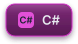

**Software developer from Riga, Latvia 🇱🇻 — building backends, Android apps and everything in between.**

---

### 🚀 About me

- 💼 1.5 years of commercial experience with **C# / .NET**, **Kotlin Android** and **Oracle**
- 📱 Shipped a production Android app with a .NET backend as the sole developer
- 🎯 Open to **Backend**, **Android (Kotlin)** and **Full-Stack** roles
- 🌍 On-site / hybrid in Riga or remote across the EU
- 🗣️ English · Latvian · Russian

---

### 🛠️ Tech stack

**Languages**

**Backend**

**Android**

**Frontend**

**Tools**

---

### 📊 GitHub stats

---

⭐ Check out my pinned repositories below

